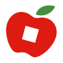

# Malus

Malus launches the macOS Roblox Player and Studio on x86-64 Linux through Rosemary. It adds a dedicated FastFlags editor and caps how much live log output the launcher keeps in memory.

## Install on Linux

You’ll need a current stable Rust toolchain, a C toolchain, pkg-config, `glib-compile-resources`, and development packages for GTK 4.18+, libadwaita 1.7+, and Pango 1.56+. Clang is optional for VR support.

```sh
git clone --branch tiltframe https://github.com/dissering/Tiltframe.git
cd Tiltframe
bash install.sh
```

Open **Malus** from your app menu or run `~/.local/bin/malus`. On first use, the launcher downloads the game client and its runtime. Malus reuses the existing Tiltframe XDG directories, so existing installs keep their settings, files, and sign-in. The native installer also provides `tiltframe` as a compatibility alias for `malus`. The managed Player bundle is `tiltframe/roblox/RobloxPlayer.app` under your XDG data directory. If both bundle names are present, Malus moves the older `Roblox.app` to `tiltframe/legacy-roblox/` once the active Player installation is valid.

## Command line

```sh
malus launch
malus launch 'roblox://experiences/start?placeId=123'
malus join 123
malus studio 'my place.rbxl'
malus settings
malus logs
```

`malus join PLACE_ID SERVER_ID` accepts a server UUID if you have one. `malus menu` opens the launcher, `malus hardware` prints driver and hardware information, and `malus diagnostics [DIRECTORY]` saves a diagnostics archive. Run `malus help` for all commands. Existing desktop shortcuts and Roblox links continue to use the original flags.

## FastFlags

Open **Settings → FastFlags** while Roblox Player is selected.

- Search by name or value, or select **Overrides only** to review your changes.
- Use **Quick settings** for low or default texture quality.
- Use **Custom overrides** to edit individual flags, import from a JSON file or pasted text, and copy or save your current settings.
- Select **Reset all** to remove every override and return to Roblox defaults.

Roblox controls which local overrides it applies. [FastFlags allowlist announcement](https://devforum.roblox.com/t/allowlist-for-local-client-configuration-via-fast-flags/3966569)

## Discord and BloxstrapRPC

Enable **Discord Rich Presence** under **Settings → General → Discord**. **Allow game activity overrides** lets an experience use BloxstrapRPC `SetRichPresence` to customize text, timestamps, and Roblox asset images. Turn it off to keep Malus’s default Discord activity. Rapid partial updates are combined so separate fields can arrive together.

The upstream SDK also defines `SetLaunchData` for invite deep links. Malus currently handles `SetRichPresence`. [BloxstrapRPC SDK](https://github.com/bloxstraplabs/bloxstrap-rpc-sdk/releases/tag/v1.1.0)

## Graphics and logs

Choose **Metal (via Vulkan)** or **OpenGL** in the launcher’s graphics settings. Enable **MangoHud** there to compare FPS, frame times, and GPU load during the same gameplay route. Malus’s log handling reduces launcher overhead during busy sessions. Gameplay FPS gains are unmeasured.

The live viewer keeps recent output. The full log for the current launch is at `${XDG_DATA_HOME:-~/.local/share}/tiltframe/logs/roblox.log`.

## Development and credits

Run `cargo run --locked` for a development build and `cargo test --locked` for the test suite. See [CONTRIBUTING.md](CONTRIBUTING.md).

Based on [Quadra 0.50.4](https://github.com/QuadraHQ/Quadra/tree/v0.50.4), powered by the [QuadraHQ Rosemary fork](https://github.com/QuadraHQ/rosemary-fork), and inspired by [Fishstrap](https://github.com/fishstrap/fishstrap). Malus is licensed under [GPL-3.0-only](LICENSE).


Navigation and action icons are from [Lucide](https://lucide.dev/). See the [Lucide license notice](assets/lucide/LICENSE).
